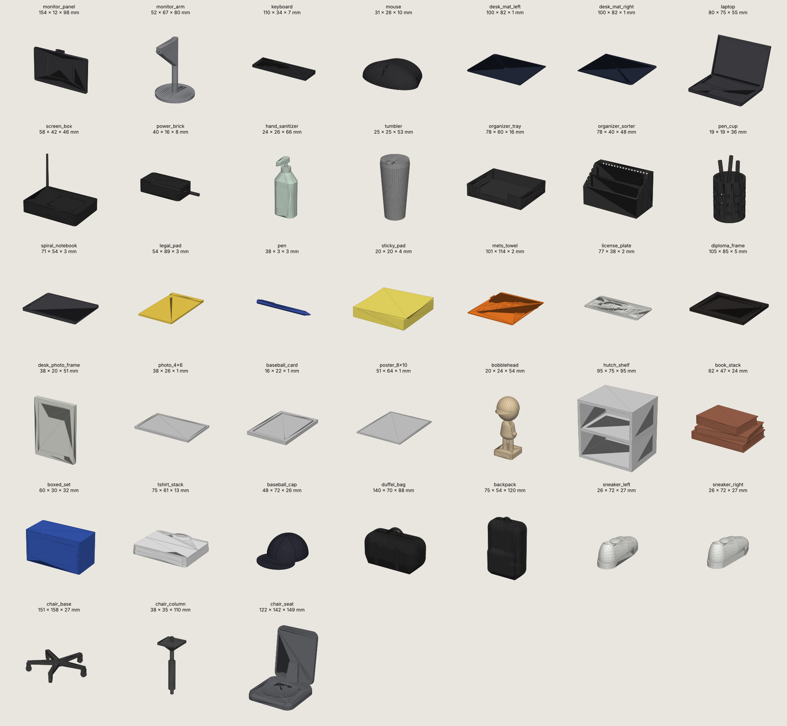

# Honey, I Shrunk the Cubicle: 1/4-scale desk minis

These are quarter-scale copies of everything in the cubicle photo, so the desk can be swapped for a tiny version of itself.
There are 38 STLs in `stl/`. Every one fits a 180 mm bed (A1 mini) and is already oriented for printing.



```
python3 -m pip install -r ../requirements.txt
python3 make_minis.py            # writes stl/*.stl and prints each part's size
python3 make_minis.py --only keyboard mouse
python3 render_minis.py          # preview.png
```

Every item is modelled at **real-world size** and scaled by `SCALE = 0.25` when exported.
The real sizes are estimates from the photo, so measure anything that needs to be convincing and change the number in its function.
To print the whole set at another scale, use `--scale 0.2` (anything above about 0.27 makes the chair seat and the mat halves too big for a 180 mm bed).

## What's here

| Group | Parts |
|---|---|
| Computer | `monitor_panel` + `monitor_arm` (a peg on the arm fits the socket on the back of the panel), `keyboard`, `mouse`, `laptop`, `screen_box` (the black box with the green screen and the aerial), `power_brick`, `desk_mat_left/right` |
| Desk top | `organizer_tray` + `organizer_sorter` (they stack), `pen_cup`, `spiral_notebook`, `legal_pad`, `pen`, `sticky_pad`, `tumbler`, `hand_sanitizer`, `tshirt_stack` |
| Walls & shelf | `mets_towel`, `license_plate`, `diploma_frame`, `desk_photo_frame`, `photo_4x6`, `baseball_card`, `poster_8x10`, `bobblehead`, `hutch_shelf`, `book_stack`, `boxed_set` |
| Floor & bags | `baseball_cap`, `duffel_bag`, `backpack`, `sneaker_left/right` |
| Chair | `chair_base` (prints upside down), `chair_column` (has a peg at each end), `chair_seat` |

## Printing notes

- **No supports needed** on any part. Overhangs were designed out: the monitor arm has a gusset, the laptop lid leans back 20°, the shelf prints lying on its back, and the chair base prints legs-down.
- **Pegs** have a 0.25 mm radial clearance. If yours are tight, sand them or scale the peg by 98%.
- **Two-colour text**: the `mets_towel` and `license_plate` text stands 0.6 mm proud. On a single-nozzle printer, add a filament change at the layer where the lettering starts (1.0 mm for both).
- **Photos, cards, the poster and the diploma** have a shallow 0.75 mm pocket. Print the real images at 25% on paper, trim them, and glue them in.
- **License plate**: the text strings (`LWA M93`, `Florida`, `SUNSHINE STATE`) were read off a blurry photo. Check them and edit `license_plate()`.
- **Colours** (as in the photo): black for the computer gear, bags, cap and organizer; light grey for the shelf; clear PETG for the sanitizer; orange for the towel; white for the sneakers and shirt.
- A full-size mat is 200 mm at 1/4, so it comes in two halves. A piece of black felt cut to 200 × 83 mm also works.

## Not included

The desk and cubicle walls themselves are not included. At 1/4 scale the L-desk is about 450 mm across, so it would need its own split-and-join design like the manga cube.
